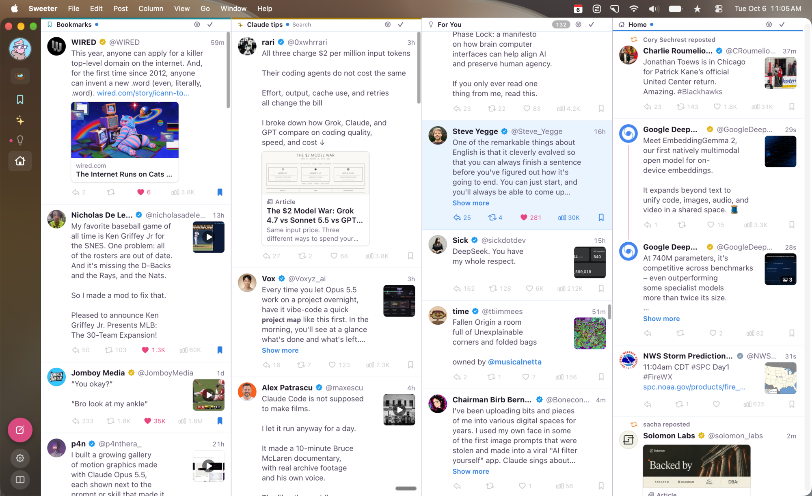

<div align="center">
  

  <h1>Sweeter</h1>

  <p><strong>A clean, customizable, keyboard-friendly face for X Pro on the Mac</strong></p>

  <p>
    <a href="https://github.com/starl3xx/sweeter/releases/latest"></a>
    
    
    
    
    
    <a href="LICENSE.md"></a>
  </p>

  <p>
    <a href="https://github.com/starl3xx/sweeter/releases/latest">Download</a> &middot;
    <a href="https://starl3xx.fun/sweeter">Website</a> &middot;
    <a href="#install">Install</a> &middot;
    <a href="#report-a-problem">Report a problem</a> &middot;
    <a href="PRIVACY.md">Privacy</a> &middot;
    <a href="https://x.com/starl3xx">@starl3xx</a>
  </p>
</div>

<p align="center"></p>

---

Sweeter draws X Pro (pro.x.com) as calm, dense columns you can read with the keyboard: unread markers that remember where you stopped, filters and mutes, merged columns, column groups, pop-out windows, a media viewer, and a command palette. It comes as a Mac app, and the same thing works as a Safari extension.

It is in early testing. Things will break when X changes X Pro.

## Before you install

1. **You need X Pro.** Sweeter is a new face for pro.x.com, not a separate service. If you can’t open [pro.x.com](https://pro.x.com) with your X account (X includes X Pro with its Premium plan and above), Sweeter has nothing to show.
2. **Mac only.** macOS 14 Sonoma or later. Built and tested on macOS 26 Tahoe; earlier versions are untested.
3. **No X API.** Sweeter makes no API calls and has no API keys. It reads the timelines the X Pro page already loads in your own window, and when you like, reply or bookmark, it presses X Pro’s own button for you, once. It never sends a request of its own to X and never reads your cookies, passwords or tokens.
4. **Anonymous usage counts, nothing more.** No accounts and no servers of its own. Your settings, filters, and reading positions stay on your Mac. Besides X Pro itself, Sweeter contacts only:
   - X’s public media server, for an image you ask it to copy or save (as Safari’s Save Image does);
   - [TelemetryDeck](https://telemetrydeck.com), from the Mac app: anonymous counts of opens, of the welcome and its Follow button, of tips turned off, and of the warnings Sweeter shows (with names and links taken out), with the Sweeter version, the theme and appearance you use, and facts about the Mac such as its macOS version, model, and language. TelemetryDeck gets a hash of a random ID made on your Mac, never your name, your X account, or anything from X. Turn it off in Settings ▸ General ▸ Usage data. The Safari extension, and Sweeter built from source, send none.
   - GitHub, to check for a newer version of Sweeter: once a day (you can turn this off in Settings) and when you choose Check for Updates;
   - a page you link in a post, from the Mac app: when you type or paste a link in the compose window, Sweeter loads that page once, without cookies, to show its title and image as X’s card will. The site sees that visit. Never for links to X. Turn it off in Settings ▸ Media;
   - GIPHY’s image servers, for the GIFs X Pro’s GIF search finds when you search in the compose window (the search itself goes to X, as in X Pro);
   - [DexScreener](https://dexscreener.com)’s public API, for token prices and logos: when you click a crypto contract address, and for ticker cards ($RSR) on screen, every few minutes at most. When DexScreener has no logo for a token, [GeckoTerminal](https://www.geckoterminal.com)’s public API is asked for it (that token’s chain and address), and the logo loads from CoinGecko. They see those requests like any website visit. Turn both off in Settings ▸ Extras. (In Safari, logos also need Sweeter allowed on cdn.dexscreener.com: Safari ▸ Settings ▸ Extensions ▸ Sweeter ▸ Edit Websites.)

   The [Privacy Policy](PRIVACY.md) has the details, and the [Terms of Use](TERMS.md) cover using Sweeter.

## Install

1. Download `Sweeter-x.y.z.zip` from the [latest release](https://github.com/starl3xx/sweeter/releases/latest) and unzip it.
2. Drag **Sweeter.app** into your Applications folder.
3. Open it. macOS stops it the first time, because this test build isn’t notarized by Apple. To allow it: open **System Settings ▸ Privacy & Security**, scroll down to “Sweeter was blocked”, and click **Open Anyway**. (Or, in Terminal: `xattr -dr com.apple.quarantine /Applications/Sweeter.app`.)
4. Sign in to X inside the Sweeter window. That’s it: Sweeter opens X Pro and draws over it.

**Updating:** choose **Sweeter ▸ Check for Updates…** (in Safari: the command palette, ⇧⌘P). Sweeter also checks once a day and tells you when a new version is out; until you update, a button above the gear in the sidebar opens the update window again. Download it, unzip it, and drag Sweeter to Applications, replacing the old one. Your settings and X sign-in live in macOS’s data folder for Sweeter, not inside the app, so they carry over.

### Optional: use it in Safari instead

The app includes a Safari extension that does the same thing on pro.x.com in Safari. Test builds aren’t signed by a registered developer, so Safari hides the extension unless you allow unsigned extensions:

1. Safari ▸ Settings ▸ Advanced: turn on **Show features for web developers**.
2. Safari ▸ Settings ▸ Developer: turn on **Allow unsigned extensions** (Safari asks for your password). Safari turns this off again each time it quits.
3. Safari ▸ Settings ▸ Extensions: turn on **Sweeter**, and allow it on pro.x.com.

The Sweeter app needs none of this.

## Using it

- The first time it opens, Sweeter shows a short welcome; after that, a tip when it opens (at most every few hours). Turn tips off in the tip itself or in Settings. **Help ▸ Welcome to Sweeter** shows the welcome again (in Safari: the command palette).
- **⌥X** shows or hides Sweeter over X Pro. Anything Sweeter doesn’t do yet is one key away in X Pro itself. The Mac app always opens in Sweeter’s view; signing in to X happens on X’s own pages, before Sweeter appears.
- **j / k** move through posts, **1–9** jump to a column, **n** writes a post, **/** finds in a column, **,** opens Settings, and **?** lists every key. X Pro’s own keys work too: **c n** adds a column, **g h** goes to Home, **d 1** switches to your first deck, and so on.
- **⇧⌘P** opens the command palette: every command, found by typing.
- **The compose window** (**n**): in the Mac app, a window of its own, like Mail’s compose window (it stays put when you switch apps and shows in Mission Control, ⌘`, and the Window menu), that keeps the size and place you give it (Settings ▸ Media ▸ Compose turns that off). **Make it a Mac window (beta)** draws it in Sweeter’s own look and your theme (its colors, Light or Dark, and accent), on plain paper: your picture and name at the top, with a pill for who can reply and **Drafts**; a native text box with real bold and italic and the Mac’s spelling; and every tool in a floating bar at the bottom: photos or a video (the bar, paste, or drop), each photo with **ALT** for its description, GIFs from X Pro’s own search in a popover, macOS’s Emoji & Symbols, **B** and **I**, a poll with lettered choices and its length as chips (1 hour, 1 day, 3 days, 7 days, or Custom), a send time from Sweeter’s own calendar and time field, in your theme’s colors (the next 9 PM or 9 AM in one click; type, scroll, or use the arrow keys on the hour, minute, or AM/PM), X Pro’s own tools (…), a ring that fills as you write, and **Post**, which says what it will do (“Schedule for Thu 9:05 PM”). Threads grow with **Add Another Post** under the post (the other posts show as rows above and below the one you’re writing), and the window opens to fit what it holds, grows as you write (until you size it yourself), and stays wide enough for the whole bar; in Safari, drag it by its title to put it where you like, and it grows as you write. In both, links are underlined (in the Mac app, with a preview card), the emoji button searches every emoji, in your skin tone (Return inserts one), and the GIF button searches X Pro’s own GIFs (from GIPHY) right there, and **B** and **I** (⌘B, ⌘I) make real bold and italic, the formatting X shows, not look-alike letters. **+** adds a post after the one you’re writing, for a thread of up to 25 posts: the others show as rows above and below it, a click edits one, and × removes it. **Post all** sends them through X Pro, in order; if X refuses one partway, the posts before it are already live, and Sweeter shows X Pro’s composer with the rest. A post over 280 characters offers **Split into N posts** beside the count (in the Mac window, in its **…** menu): it becomes a thread, cut at blank lines first and then at sentence ends, each part ending “1/3” (Settings ▸ Media turns the numbers off); its media stay with the first part, and bold and italic are left out. The poll button adds a poll under your text, which is its question: two to four choices of up to 25 characters and a length from 5 minutes to 7 days, as X Pro allows; a poll can’t go with media or in a quote. **ALT** on a photo adds its description for people who can’t see it (up to 1,000 characters, as X takes), and Sweeter types it into X Pro’s own description editor when you post. The schedule button sets a date and time for the post, or for the whole thread, in your Mac’s time zone (an hour from now at first; up to 18 months ahead, as X Pro allows); **Schedule** hands it to X Pro’s own schedule. X Pro can’t schedule a poll, a post not everyone can reply to, or a reply over 280 characters, and it schedules a reply without bold or italic, so Sweeter says so first. Location and Grok images open X Pro’s own composer with your text; Open in X Pro takes a poll and a time there filled in. X Pro can’t add a Grok image to a poll. If you turned on X’s reminder to add image descriptions, Sweeter asks the same question when you post: **Describe in X Pro** opens X Pro’s own description editor, **Not This Time** posts without them, and **Cancel** keeps your post here. **Edit post** in X Pro’s menu for one of your posts (… ▸ X Pro’s Menu for This Post…) opens the compose window with the post’s text, links in full: change the text, bold, or italic, and **Update** sends it through X Pro’s own Edit, which keeps the media and the quoted post. The window says until when X lets you edit and when it’s your last edit, and the new version takes the old one’s place in your columns. What you write is saved as a draft as you go, on your Mac, so a quit or a crash loses nothing; **⌘S** saves at any time. Closing a window that holds something asks **Save**, **Cancel**, or **Delete Draft**. **New Post** always starts empty, and **Drafts** (a pill with a count at the top of the compose window) lists your saved posts, replies, and quotes, newest first: choose one to go on with it, or delete it (×, or hold ⌥ in the Mac window). A reply or quote comes back when you open the same post’s Reply or Quote again too. Drafts stay 30 days (the newest 50), and attached files stay only until Sweeter closes. Your drafts on X are in **Drafts** too, marked “On X” (**g f** opens the list), and **Save** (⌘S, or Save when you close) also saves a new post to your drafts on X, with its photos, video, or GIF, so X’s other apps have it; saved again after a change, the copy on X is replaced. A poll, a thread, a reply, a send time, and who can reply stay on your Mac only. Sweeter does this through a Drafts column in your X Pro deck, which it adds if needed and keeps out of sight (Settings ▸ Media ▸ Drafts). A draft on X with only text opens in the compose window, and one with media, a reply, a quote, or a thread opens in X Pro’s own composer, with what X holds. Posting or deleting a draft deletes its copy on X too.
- **Conversations:** click a post to open its conversation in its column. When the author keeps replying to themselves, **Read Thread** at the top opens the whole run in Sweeter’s reader as one page: the first line as its title, then every post’s text, pictures and videos, quoted posts, and links. A reply you post shows in the open conversation at once, under the post it answers. Replies from accounts under a month old, from accounts with no profile picture, or that one of your mutes matches fold behind **Show hidden replies** at the end, which says why (Settings ▸ General ▸ Reply spam sets the age, or turns it off). You, the post’s author, and people you follow never fold.
- **What X adds to a post** shows as X shows it: a pencil after the time marks an edited post (an older version links to the latest), Community Notes appear under the post, and organizations keep their square avatars. When the author limits who can reply and you aren’t one of them, the reply button dims and says who can. A poll offers its choices until you vote or it ends, as X does: a click votes through X Pro’s own poll, and then the results show, with your vote checked and the time left.
- **X Articles** open in Sweeter’s reader, with the post’s own like, repost, reply, and bookmark buttons under them. **−** and **+** change the text size, and the reader offers four typefaces: sans serif, serif (Iowan Old Style), rounded, and monospace, plus Söhne in the Mac app when it’s installed. Posts the article embeds show in it too. X Pro loads an article’s text with its conversation, so Sweeter opens that conversation in the post’s column and closes it again. ⌘-click an article to open it on x.com, or turn the reader off in Settings ▸ Media.
- **X Pro’s menu for a post:** the **…** button in the action bar (in the Mac app, also **X Pro’s Menu for This Post** when you right-click a post) shows what X Pro offers that post right now: Delete, Pin, and Edit on your own posts; Follow, Mute, Block, Report, Mute this conversation, Bookmark to Folder, and the rest on others’. Delete, Pin, Block, and Unfollow ask first. A report, the lists, an edit, or anything else X Pro opens shows in X Pro, and Sweeter comes back when it closes. **u** mutes and **x** blocks a post’s author, as in X Pro.
- **Filters** (the funnel in a column header, or ⌥1 to ⌥9) show only some of a column’s loaded posts: media, links, no reposts or replies, mutuals, and more built in. Your own (Settings ▸ Filters) take words to include or hide, rules matched All or Any, at least so many likes, reposts, or replies, and languages (X’s codes, like en or ja; a post with no words, like a photo alone, still shows). X Pro offers minimum counts and a language only inside a search.
- **Mutes** (Settings ▸ Filters ▸ Mutes) hide posts by word, `/regex/`, `@user`, `#hashtag`, or `via:Client`, for a day, a week, a month, or forever. A word or regex also checks image descriptions, poll choices, link card titles, Article titles, and the post a post quotes, and `@user` and `#hashtag` check the quoted post too. Each mute says how many loaded posts it hides now, and **Show** brings them back for a moment, each marked with the mute, until **Hide Again**. Sweeter’s mutes stay on this Mac; X’s own Mute (in a post’s or profile’s menu) works everywhere.
- **Live video on X:** click a live video’s card (LIVE) and it plays in Sweeter’s viewer, where **p** puts it in Picture in Picture. Sweeter plays the stream X Pro gets when it plays the video itself: if X Pro has none yet, Sweeter opens the post’s conversation in X Pro and waits a few seconds, and otherwise opens the video on x.com, as before (⌘-click always does).
- **Picture in Picture:** press **p** on a post with a video (or its quoted post’s), or use **Picture in Picture** in the viewer or the video’s right-click menu, and the video plays in the Mac’s own floating window, above every app, while you read on. The window’s close button (or **p** again) stops it; its return button shows it in Sweeter’s viewer again.
- **The action bar** under each post shows how many times X counted the post seen, beside the likes. Settings ▸ General ▸ Action bar picks which buttons it holds; the keys (**r**, **t**, **l**, **b**) work either way.
- **Themes:** Classic (Tweetbot’s colors), Sweeter, Catppuccin, Nord, and Dracula, each in light and dark, in Settings ▸ General ▸ Theme. Appearance follows macOS or stays light or dark.
- Each column’s **…** menu holds its filters, width, Icon & Color, merge, groups and pop-out window, and starts with the column’s health: when X Pro last refreshed it and about how often it does (every 30 s for most columns, longer for searches and Top). A clock in the header means a column has missed a few refreshes, or that X refused the last one (too many requests: X Pro backs off and tries again by itself); point at it for which.
- In the Mac app, double-click the window’s left or right edge to fit it to your columns, and switching to a deck with more or fewer columns fits it too; a deck of one column can be as narrow as one column. **⌘Y** shows a post’s photos in Quick Look, an alert for a post has **Like** and **Reply** buttons, every **Share** menu is the Mac’s own, and Shortcuts and Spotlight have **New Post**, **Next Unread**, **Open Column**, and **Show Sweeter**.
- In the Mac app, Settings ▸ General ▸ **Open links in** picks the browser links open in (any app on your Mac that opens web pages), and **Open X links in** can pick another one for x.com and twitter.com links.
- Crypto contract addresses in posts are links: click one for its price, liquidity, and market cap, and again to close it (⌘-click opens DexScreener). Tickers X tags, like $RSR, get a price card under the post.

Columns are X Pro’s own columns. When you add, remove, rename, or reorder one in Sweeter (drag a column by its title, or press ⌥⌘← and ⌥⌘→), Sweeter does it with X Pro’s own controls, so the change follows you to every device. Decks work the same way: **New Deck** and **Edit Deck**, in the deck menu, ask for a name and an emoji, and **All Decks** (or **Manage Decks**) moves a deck up or down, pins or unpins it, edits it, or deletes it, after asking. A search column takes X’s search syntax (`from:`, `url:`, `-filter:replies`, and more), and Add a column ▸ Search has the same filters as X Pro’s search, as a form: words, an exact phrase, any or none of some words, hashtags, a language, the accounts it is from, replies to, or mentions, only verified accounts or accounts you follow, replies, reposts, quotes, and links (include, only, or leave out), a site it links to, photos or videos, at least so many replies, likes, or reposts, and dates. Each field writes the query, and typing the query fills the fields; anything the form doesn’t cover stays in the query as you typed it. Edit Search…, in a search column’s … menu, changes its query in the same sheet. The bookmark beside the query saves a search, and the searches you add or change stay under it as Recent: click one to use it again. A search column’s … menu has **Saved Searches**, which runs one in that column, and the command palette lists them too. Saved and recent searches stay on this Mac. Add a column ▸ List… has **New List…**, which opens X Pro’s own Create List, and a list column’s … menu opens **Edit List** (your own lists) and **List Members** on x.com, since X Pro has no list editor of its own. Sweeter’s own touches (colors, icons, filters, merged columns, groups) stay on this Mac. Communities, your Communities, bookmark folders, lists ordered by Top, and Verified or Priority notifications show as columns too, and a search on the People tab, Followers, or Following shows people. A Scheduled posts column (Add a column ▸ Scheduled posts) lists your scheduled posts, soonest first, with when each sends and which X couldn’t send: **Edit in X Pro** opens one in X Pro’s own composer, and **Delete…** deletes it after asking. A column Sweeter can’t show yet (Trends, Quotes, and others) keeps its place with a Show X Pro button. One exception to “X Pro as it is”: X has started moving Bookmarks to a History page that X Pro can’t show in a column, so Sweeter turns that one change off in X Pro’s page, and Bookmarks columns keep loading as before.

## Report a problem

In the Mac app choose **Help ▸ Report a Problem…**; in Safari open the command palette (⇧⌘P) and choose **Report a Problem…**, or use the link at the bottom of Settings. It opens a [GitHub issue](https://github.com/starl3xx/sweeter/issues/new?template=bug_report.yml) already filled in with Sweeter’s version, your macOS or Safari version, X’s language and the last error Sweeter showed. Nothing else is included, and nothing is sent until you submit it. Issues are public, so leave out anything private.

## Build from source

Needs Xcode 26 or later and Node.js.

```sh
node tests/run.js            # the tests
node license/test.mjs        # the license server (license/README.md)
scripts/build-safari.sh      # builds and installs /Applications/Sweeter.app
```

Without a Team ID the build is signed ad hoc. To sign with your own Apple Development certificate, put `SWEETER_TEAM=<your Team ID>` in `scripts/local.env` (git ignores it). `scripts/release.sh` makes the downloadable zip.

How it works: `extension/src/page/recorder.js` listens to the responses X Pro’s page receives (it never sends anything); `extension/src/lib` turns them into timelines; `extension/src/ui` draws Sweeter; `extension/src/content/xpro.js` presses X Pro’s buttons. `safari/Sweeter` is the Mac app, which runs the same scripts in its own web view.

## License

[PolyForm Noncommercial 1.0.0](LICENSE.md). Free to use, change, and share for any noncommercial purpose. Selling Sweeter or a version of it is not allowed.

Sweeter is independent. It is not made, endorsed, or sponsored by X Corp., and it is not affiliated with X, X Pro, or TweetDeck. X, X Pro, and TweetDeck are trademarks of X Corp.; Tweetbot is a trademark of Tapbots. See the [Terms of Use](TERMS.md) and the [Privacy Policy](PRIVACY.md).
